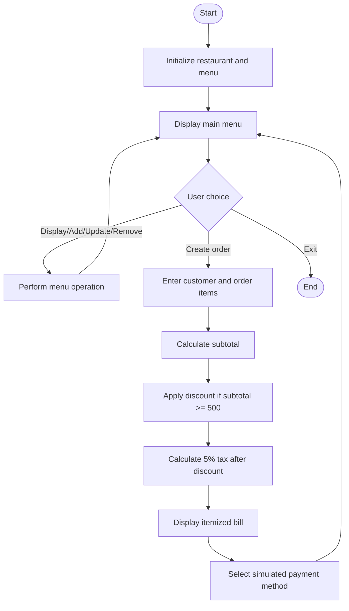

# Algorithms

## Main program
1. Start.
2. Create the restaurant and initialize a sample menu.
3. Display the main menu.
4. Read and validate the user's choice.
5. Perform menu display, add, update, remove, or order creation.
6. For an order, read customer details and collect food items and positive quantities.
7. Calculate the subtotal from each line item's price × quantity.
8. Apply a 10% discount when subtotal ≥ ₹500.
9. Calculate 5% tax on subtotal minus discount.
10. Display an itemized bill.
11. Accept a cash, UPI, or card simulation selection.
12. Return to the main menu, or exit when the user chooses 0.

## Billing
```
subtotal = sum(price * quantity for each order line)
if subtotal >= 500:
    discount = round(subtotal * 0.10, 2)
else:
    discount = 0.00
taxableAmount = subtotal - discount
tax = round(taxableAmount * 0.05, 2)
total = taxableAmount + tax
```

## Flowchart (Mermaid)
