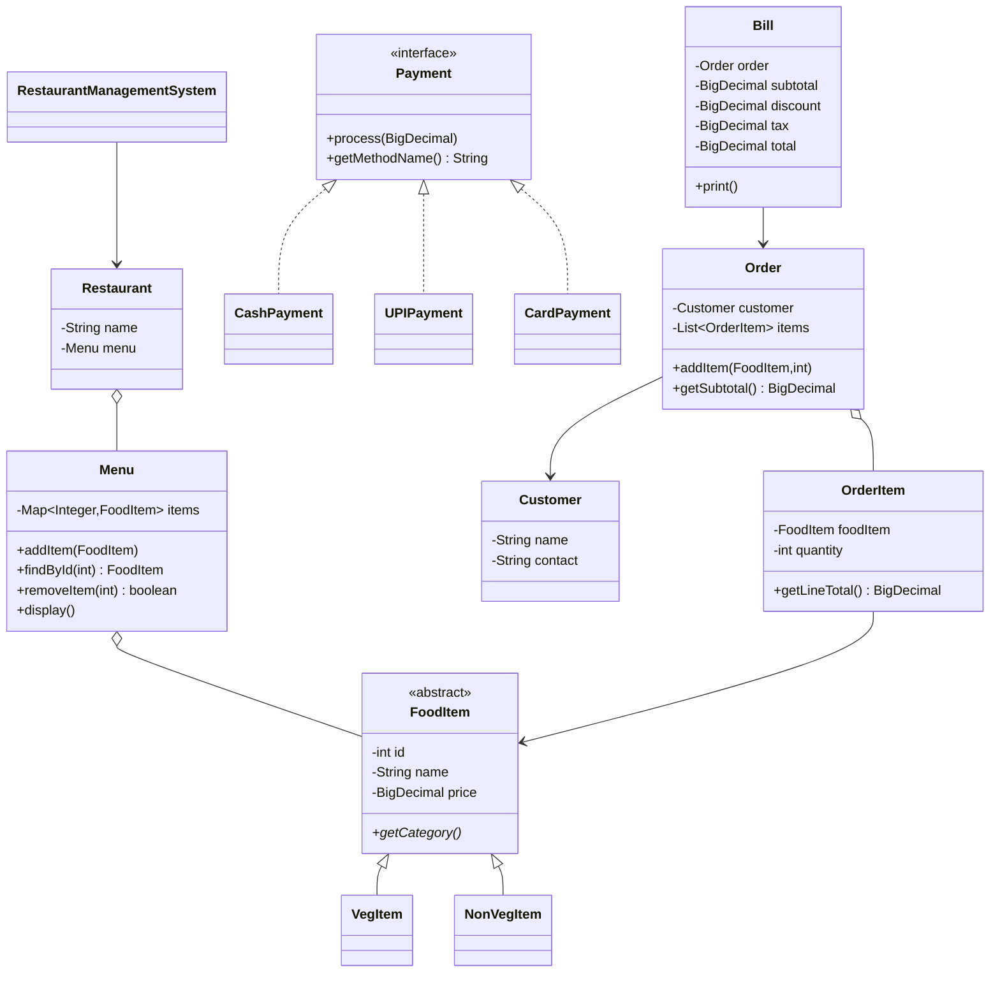

# Class Design

The main class currently contains the console controller and menu actions. The project is deliberately kept in one Java source file for easy compilation in a beginner environment; all supporting classes are package-private classes in that file.